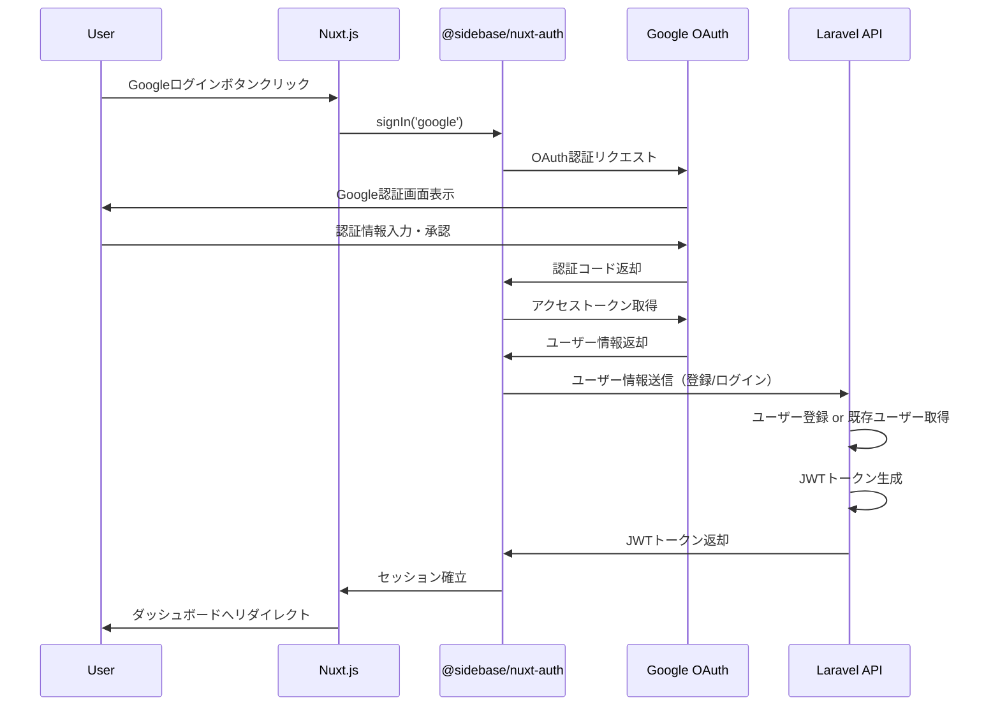

# TF-5: Googleログイン実装（Nuxt Auth使用）

## 概要

Nuxt.js 3プロジェクトにGoogle OAuth 2.0ログイン機能を実装します。
NextAuth.jsはNext.js専用のため、Nuxt 3では`@sidebase/nuxt-auth`（Nuxt版NextAuth）を使用します。

## 技術スタック

- **認証ライブラリ**: `@sidebase/nuxt-auth` v0.9.x
- **OAuth プロバイダー**: Google OAuth 2.0
- **バックエンド連携**: 既存のLaravel JWT認証と統合
- **セッション管理**: JWT + サーバーサイドセッション

## 実装要件

### 1. 機能要件

- [ ] Google OAuth 2.0によるログイン機能
- [ ] 既存のメール/パスワード認証との共存
- [ ] ユーザー情報の自動登録（初回ログイン時）
- [ ] セッション管理とトークンリフレッシュ
- [ ] ログアウト機能
- [ ] 認証状態の永続化

### 2. 非機能要件

- [ ] セキュアなトークン管理（HTTPOnly Cookie推奨）
- [ ] CSRF保護
- [ ] エラーハンドリング
- [ ] ローディング状態の表示
- [ ] レスポンシブデザイン

## アーキテクチャ設計

### 認証フロー



### データモデル拡張

#### Usersテーブル拡張

既存のusersテーブルに以下のカラムを追加：

```sql
ALTER TABLE users ADD COLUMN google_id VARCHAR(255) UNIQUE NULL;
ALTER TABLE users ADD COLUMN avatar VARCHAR(255) NULL;
ALTER TABLE users MODIFY COLUMN password VARCHAR(255) NULL;
```

- `google_id`: Google OAuth固有のユーザーID
- `avatar`: プロフィール画像URL
- `password`: NULL許可（OAuth専用ユーザー対応）

## 実装手順

### Phase 1: 環境設定とパッケージインストール

#### 1.1 Google Cloud Consoleでの設定

1. [Google Cloud Console](https://console.cloud.google.com/)にアクセス
2. プロジェクト作成または既存プロジェクト選択
3. 「APIとサービス」→「認証情報」へ移動
4. 「認証情報を作成」→「OAuthクライアントID」を選択
5. アプリケーションの種類：「ウェブアプリケーション」
6. 承認済みのリダイレクトURI：
   - 開発環境: `http://localhost:3000/api/auth/callback/google`
   - 本番環境: `https://yourdomain.com/api/auth/callback/google`
7. クライアントIDとクライアントシークレットを取得

#### 1.2 Nuxt Auth パッケージインストール

```bash
cd frontend
npm install @sidebase/nuxt-auth@^0.9.0
```

#### 1.3 環境変数設定

`frontend/.env`に以下を追加：

```env
# Google OAuth
GOOGLE_CLIENT_ID=your-google-client-id
GOOGLE_CLIENT_SECRET=your-google-client-secret

# Auth Secret (ランダムな文字列を生成)
NUXT_AUTH_SECRET=your-random-secret-string-here

# Auth Origin (本番環境URL)
NUXT_AUTH_ORIGIN=http://localhost:3000
```

**セキュリティ注意**: 
- `NUXT_AUTH_SECRET`は`openssl rand -base64 32`で生成推奨
- `.env`ファイルは`.gitignore`に含まれていることを確認

### Phase 2: バックエンド実装

#### 2.1 データベースマイグレーション作成

```bash
cd backend
php artisan make:migration add_google_auth_to_users_table
```

マイグレーションファイル内容：

```php
<?php

use Illuminate\Database\Migrations\Migration;
use Illuminate\Database\Schema\Blueprint;
use Illuminate\Support\Facades\Schema;

return new class extends Migration
{
    public function up(): void
    {
        Schema::table('users', function (Blueprint $table) {
            $table->string('google_id')->unique()->nullable()->after('email');
            $table->string('avatar')->nullable()->after('google_id');
            $table->string('password')->nullable()->change();
        });
    }

    public function down(): void
    {
        Schema::table('users', function (Blueprint $table) {
            $table->dropColumn(['google_id', 'avatar']);
            $table->string('password')->nullable(false)->change();
        });
    }
};
```

マイグレーション実行：

```bash
php artisan migrate
```

#### 2.2 Userモデル更新

`backend/app/Models/User.php`の`$fillable`配列に追加：

```php
protected $fillable = [
    'name',
    'email',
    'password',
    'google_id',
    'avatar',
];
```

#### 2.3 Google認証用コントローラー作成

```bash
php artisan make:controller API/GoogleAuthController
```

`backend/app/Http/Controllers/API/GoogleAuthController.php`:

```php
<?php

namespace App\Http\Controllers\API;

use App\Http\Controllers\Controller;
use App\Models\User;
use Illuminate\Http\JsonResponse;
use Illuminate\Http\Request;
use Illuminate\Support\Facades\Auth;
use Illuminate\Support\Facades\Validator;

class GoogleAuthController extends Controller
{
    /**
     * Google OAuth認証後のユーザー登録/ログイン処理
     */
    public function handleGoogleCallback(Request $request): JsonResponse
    {
        $validator = Validator::make($request->all(), [
            'google_id' => 'required|string',
            'email' => 'required|email',
            'name' => 'required|string',
            'avatar' => 'nullable|url',
        ]);

        if ($validator->fails()) {
            return response()->json(['errors' => $validator->errors()], 422);
        }

        // Google IDで既存ユーザーを検索
        $user = User::where('google_id', $request->google_id)->first();

        if (!$user) {
            // メールアドレスで既存ユーザーを検索（アカウント統合）
            $user = User::where('email', $request->email)->first();

            if ($user) {
                // 既存ユーザーにGoogle IDを紐付け
                $user->update([
                    'google_id' => $request->google_id,
                    'avatar' => $request->avatar ?? $user->avatar,
                ]);
            } else {
                // 新規ユーザー作成
                $user = User::create([
                    'name' => $request->name,
                    'email' => $request->email,
                    'google_id' => $request->google_id,
                    'avatar' => $request->avatar,
                    'password' => null, // OAuth専用ユーザー
                ]);
            }
        } else {
            // ユーザー情報を更新
            $user->update([
                'name' => $request->name,
                'avatar' => $request->avatar ?? $user->avatar,
            ]);
        }

        // JWTトークン生成
        $token = Auth::guard('api')->login($user);

        if (!is_string($token)) {
            return response()->json(['error' => 'Could not create token'], 500);
        }

        return $this->respondWithToken($token);
    }

    /**
     * トークンレスポンス
     */
    protected function respondWithToken(string $token): JsonResponse
    {
        $guard = Auth::guard('api');
        $ttl = 3600;

        if (method_exists($guard, 'factory') && $guard->factory()) {
            $ttl = $guard->factory()->getTTL() * 60;
        }

        return response()->json([
            'access_token' => $token,
            'token_type' => 'bearer',
            'expires_in' => $ttl,
            'user' => $guard->user(),
        ]);
    }
}
```

#### 2.4 APIルート追加

`backend/routes/api.php`に追加：

```php
use App\Http\Controllers\API\GoogleAuthController;

Route::post('auth/google/callback', [GoogleAuthController::class, 'handleGoogleCallback'])
    ->name('google.callback');
```

### Phase 3: フロントエンド実装

#### 3.1 Nuxt Auth設定

`frontend/nuxt.config.ts`を更新：

```typescript
export default defineNuxtConfig({
  // ... 既存設定
  modules: [
    '@pinia/nuxt',
    '@sidebase/nuxt-auth',
    // ... 他のモジュール
  ],
  
  auth: {
    baseURL: process.env.NUXT_AUTH_ORIGIN || 'http://localhost:3000',
    provider: {
      type: 'authjs',
    },
    globalAppMiddleware: {
      isEnabled: false, // 手動で認証ミドルウェアを適用
    },
  },
  
  runtimeConfig: {
    // サーバーサイド専用（シークレット）
    authSecret: process.env.NUXT_AUTH_SECRET,
    googleClientId: process.env.GOOGLE_CLIENT_ID,
    googleClientSecret: process.env.GOOGLE_CLIENT_SECRET,
    
    public: {
      // クライアントサイドでも使用可能
      apiBase: process.env.BROWSER_API_BASE_URL || 'http://localhost:8000/api',
      serverApiBase: process.env.SERVER_API_BASE_URL || 'http://laravel.test/api',
      appEnv: process.env.NODE_ENV || 'development',
    },
  },
})
```

#### 3.2 Auth.js設定ファイル作成

`frontend/server/api/auth/[...].ts`を作成：

```typescript
import { NuxtAuthHandler } from '#auth'
import GoogleProvider from 'next-auth/providers/google'

export default NuxtAuthHandler({
  secret: useRuntimeConfig().authSecret,
  
  providers: [
    // @ts-expect-error
    GoogleProvider.default({
      clientId: useRuntimeConfig().googleClientId,
      clientSecret: useRuntimeConfig().googleClientSecret,
    }),
  ],
  
  callbacks: {
    async jwt({ token, account, profile }) {
      // 初回ログイン時（accountが存在する場合）
      if (account && profile) {
        // LaravelバックエンドにGoogle認証情報を送信
        const config = useRuntimeConfig()
        const apiBase = config.public.serverApiBase
        
        try {
          const response = await $fetch(`${apiBase}/auth/google/callback`, {
            method: 'POST',
            body: {
              google_id: profile.sub,
              email: profile.email,
              name: profile.name,
              avatar: profile.picture,
            },
          })
          
          // LaravelからのJWTトークンを保存
          token.accessToken = response.access_token
          token.user = response.user
        } catch (error) {
          console.error('Backend authentication failed:', error)
        }
      }
      
      return token
    },
    
    async session({ session, token }) {
      // セッションにユーザー情報とトークンを含める
      session.accessToken = token.accessToken
      session.user = token.user
      return session
    },
  },
  
  pages: {
    signIn: '/login',
    error: '/login',
  },
})
```

#### 3.3 認証コンポーザブル拡張

`frontend/composables/useAuth.ts`を更新：

```typescript
import { useRouter } from 'vue-router'
import { useAuthStore } from '~/stores/auth'

export function useAuth() {
  const authStore = useAuthStore()
  const router = useRouter()
  const { signIn, signOut, status, data } = useAuth()

  return {
    // 既存のメール/パスワード認証
    async loginAndRedirect(
      email: string,
      password: string,
      redirectPath?: string
    ) {
      await authStore.login(email, password)
      router.push(redirectPath || '/')
    },

    async registerAndRedirect(
      name: string,
      email: string,
      password: string,
      passwordConfirmation: string,
      redirectPath?: string
    ) {
      await authStore.register(name, email, password, passwordConfirmation)
      router.push(redirectPath || '/')
    },

    // Google OAuth認証
    async loginWithGoogle(redirectPath?: string) {
      await signIn('google', { 
        callbackUrl: redirectPath || '/',
        redirect: true,
      })
    },

    async logoutAndRedirect(redirectPath?: string) {
      // Nuxt Authのログアウト
      await signOut({ callbackUrl: redirectPath || '/login' })
      // Piniaストアもクリア
      await authStore.logout()
    },

    // 認証状態
    isAuthenticated: computed(() => status.value === 'authenticated'),
    session: computed(() => data.value),
  }
}
```

#### 3.4 ログインページ更新

`frontend/pages/login.vue`にGoogleログインボタンを追加：

```vue
<template>
  <v-container class="fill-height" fluid>
    <v-row align="center" justify="center">
      <v-col cols="12" sm="8" md="4">
        <v-card class="elevation-12">
          <v-toolbar color="primary" dark flat>
            <v-toolbar-title>ログイン</v-toolbar-title>
          </v-toolbar>
          
          <v-card-text>
            <!-- エラーメッセージ -->
            <v-alert
              v-if="error"
              type="error"
              dismissible
              @click:close="error = null"
            >
              {{ error }}
            </v-alert>

            <!-- メール/パスワードログインフォーム -->
            <v-form ref="form" v-model="valid" @submit.prevent="handleLogin">
              <v-text-field
                v-model="email"
                label="メールアドレス"
                type="email"
                :rules="emailRules"
                required
                prepend-icon="mdi-email"
              />
              
              <v-text-field
                v-model="password"
                label="パスワード"
                type="password"
                :rules="passwordRules"
                required
                prepend-icon="mdi-lock"
              />
              
              <v-btn
                type="submit"
                color="primary"
                block
                :loading="loading"
                :disabled="!valid"
                class="mt-4"
              >
                ログイン
              </v-btn>
            </v-form>

            <!-- 区切り線 -->
            <v-divider class="my-6" />
            <div class="text-center text-caption mb-4">または</div>

            <!-- Googleログインボタン -->
            <v-btn
              color="white"
              block
              variant="outlined"
              prepend-icon="mdi-google"
              @click="handleGoogleLogin"
              :loading="googleLoading"
            >
              Googleでログイン
            </v-btn>

            <!-- 登録リンク -->
            <div class="text-center mt-4">
              <router-link to="/register" class="text-decoration-none">
                アカウントをお持ちでない方はこちら
              </router-link>
            </div>
          </v-card-text>
        </v-card>
      </v-col>
    </v-row>
  </v-container>
</template>

<script setup lang="ts">
import { ref } from 'vue'
import { useAuth } from '~/composables/useAuth'

const { loginAndRedirect, loginWithGoogle } = useAuth()

const email = ref('')
const password = ref('')
const valid = ref(false)
const loading = ref(false)
const googleLoading = ref(false)
const error = ref<string | null>(null)

const emailRules = [
  (v: string) => !!v || 'メールアドレスは必須です',
  (v: string) => /.+@.+\..+/.test(v) || '有効なメールアドレスを入力してください',
]

const passwordRules = [
  (v: string) => !!v || 'パスワードは必須です',
  (v: string) => v.length >= 8 || 'パスワードは8文字以上である必要があります',
]

const handleLogin = async () => {
  if (!valid.value) return

  loading.value = true
  error.value = null

  try {
    await loginAndRedirect(email.value, password.value)
  } catch (e: any) {
    error.value = e.message || 'ログインに失敗しました'
  } finally {
    loading.value = false
  }
}

const handleGoogleLogin = async () => {
  googleLoading.value = true
  error.value = null

  try {
    await loginWithGoogle()
  } catch (e: any) {
    error.value = 'Googleログインに失敗しました'
    googleLoading.value = false
  }
}
</script>
```

### Phase 4: テストとデバッグ

#### 4.1 動作確認項目

- [ ] Googleログインボタンが表示される
- [ ] クリックでGoogle認証画面に遷移
- [ ] Google認証後、ダッシュボードにリダイレクト
- [ ] 初回ログイン時、ユーザーがDBに登録される
- [ ] 2回目以降のログイン時、既存ユーザーとして認証される
- [ ] メールアドレスが同じ場合、アカウントが統合される
- [ ] ログアウトが正常に動作する
- [ ] セッションが永続化される（ページリロード後も認証状態維持）

#### 4.2 デバッグ方法

**フロントエンド:**
```bash
cd frontend
npm run dev
```

ブラウザコンソールで認証状態確認：
```javascript
// Nuxt Auth状態
console.log(useAuth())

// Piniaストア状態
console.log(useAuthStore())
```

**バックエンド:**
```bash
cd backend
php artisan serve

# ログ確認
tail -f storage/logs/laravel.log
```

**データベース確認:**
```bash
# Docker環境の場合
docker exec -it postgres psql -U sail -d laravel_nuxt_template

# SQLite環境の場合
sqlite3 backend/database/database.sqlite
```

```sql
-- ユーザー一覧確認
SELECT id, name, email, google_id, avatar FROM users;
```

## セキュリティ考慮事項

### 1. 環境変数の管理

- [ ] `.env`ファイルを`.gitignore`に追加済み
- [ ] 本番環境では環境変数を安全に管理（Fly.io Secrets等）
- [ ] `NUXT_AUTH_SECRET`は強力なランダム文字列を使用

### 2. CORS設定

`backend/config/cors.php`を確認：

```php
'paths' => ['api/*', 'sanctum/csrf-cookie'],
'allowed_origins' => [
    env('FRONTEND_URL', 'http://localhost:3000'),
],
'supports_credentials' => true,
```

### 3. CSRFトークン

Nuxt Authは自動的にCSRF保護を提供しますが、追加の設定が必要な場合：

```typescript
// frontend/nuxt.config.ts
export default defineNuxtConfig({
  security: {
    headers: {
      crossOriginEmbedderPolicy: 'require-corp',
      crossOriginOpenerPolicy: 'same-origin-allow-popups',
    },
  },
})
```

### 4. HTTPOnly Cookie

セッショントークンはHTTPOnly Cookieとして保存され、XSS攻撃から保護されます。

## トラブルシューティング

### エラー: "redirect_uri_mismatch"

**原因**: Google Cloud ConsoleのリダイレクトURIが正しく設定されていない

**解決策**:
1. Google Cloud Consoleで「認証情報」を確認
2. 承認済みのリダイレクトURIに以下を追加：
   - `http://localhost:3000/api/auth/callback/google`
   - `http://localhost:3000/api/auth/callback/google/`（末尾スラッシュあり）

### エラー: "NUXT_AUTH_SECRET is not set"

**原因**: 環境変数が設定されていない

**解決策**:
```bash
# ランダムシークレット生成
openssl rand -base64 32

# frontend/.envに追加
NUXT_AUTH_SECRET=生成された文字列
```

### エラー: "Backend authentication failed"

**原因**: LaravelバックエンドとNuxtフロントエンドの通信エラー

**解決策**:
1. Laravelが起動しているか確認: `http://localhost:8000/api/auth/me`
2. CORS設定を確認
3. ネットワークタブでAPIリクエストを確認

### ユーザーが重複作成される

**原因**: メールアドレスでのアカウント統合が動作していない

**解決策**:
1. `GoogleAuthController`のロジックを確認
2. データベースの`email`カラムにユニーク制約があるか確認

## 今後の拡張案

- [ ] 他のOAuthプロバイダー追加（GitHub, Facebook等）
- [ ] 2要素認証（2FA）の実装
- [ ] パスワードリセット機能
- [ ] メール認証機能
- [ ] ユーザープロフィール編集機能
- [ ] アカウント削除機能

## 参考資料

- [@sidebase/nuxt-auth公式ドキュメント](https://sidebase.io/nuxt-auth/getting-started)
- [NextAuth.js公式ドキュメント](https://next-auth.js.org/)
- [Google OAuth 2.0ドキュメント](https://developers.google.com/identity/protocols/oauth2)
- [Laravel JWT認証](https://github.com/PHP-Open-Source-Saver/jwt-auth)
